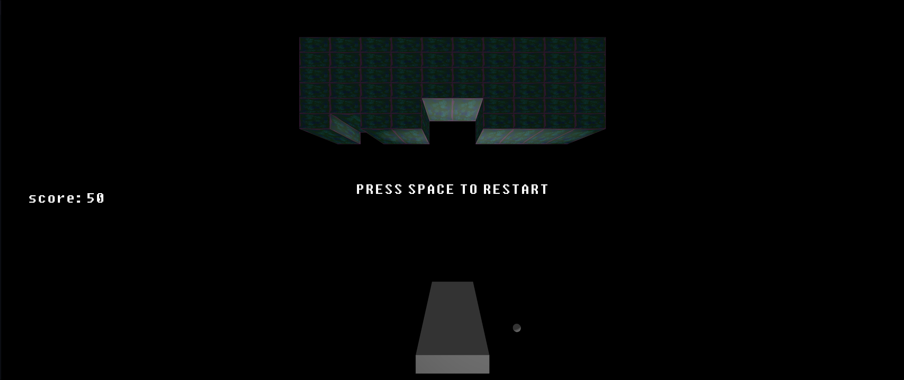

# Psk proj podsawy grafiki komupterowej 2

- 3D Arkanoid game.

## Showcase


# How to play?

- Compile & run game target (found in build/src). 

## Controls

- Pallete `wsad`
- Restart `Space`
- Some extra `n`, `m`.

## Interface

Score and restart text on stage end.

<p align=center>
	
</p>

# Compiling 

Project uses CMake and C++.

Upstream projects used:

- https://github.com/rafal11ck/opengl-3d-engine   (This does not fetch automaticaly fetch all libs it uses at time of writing) 
- gl_text

CMake will fetch libraries required for this project.

```sh
mkdir build
cmake -B build -S src
cmake -Bj ./build 
```

## Dependencies
- C++
- CMake

## Code documentation

Generated by CMake using Doxygen during compilation.


